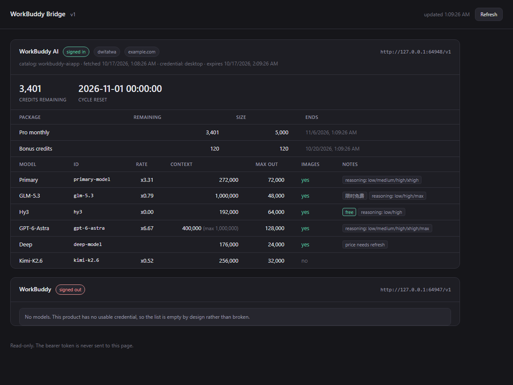

# The standalone bridge

`workbuddy-bridge` exposes the models in a signed-in **WorkBuddy** desktop app
over a local, OpenAI-compatible HTTP endpoint, so *any* agent that accepts a
base URL can use them — Claude Code, Codex CLI, Cursor, Continue, the OpenAI
SDK, or your own code.

It is the same bridge DeepSeek Harness uses. Nothing about the wire behaviour
was forked: both frontends run one shared core.

---

## Layout

```
src/
  core/         the bridge — no agent, no harness, no third-party deps
  dsh/          the DeepSeek Harness plugin frontend
  standalone/   the CLI + embeddable runner frontend
```

`src/core/` imports **only** Node builtins. That is the whole point of the
split: the bridge was never DSH-specific, and now it does not claim to be.
Verify it yourself:

```sh
grep -rhoE "from '[^']+'" src/core src/standalone | grep -v "from '\./"
# → only node:... specifiers
```

### What is 1:1 with the original

Every module below was moved verbatim. The only edits were import paths.

| Module | Role |
|---|---|
| `core/shim.ts` | the loopback OpenAI-compatible endpoint |
| `core/loopback.ts` | Host / Origin loopback gates |
| `core/upstream.ts` | the WorkBuddy wire client, quirks and all |
| `core/auth.ts` | read-only reuse of the desktop sign-in |
| `core/catalog.ts`, `core/catalog-store.ts` | the model list and its cache |
| `core/variants.ts` | the CN and international product descriptors |
| `core/desktop-credential-protection.ts` | WorkBuddy 5.6 at-rest key handling |
| `core/probe*.ts`, `core/visibility-store.ts` | reasoning detection, hidden models |
| `core/client-identity.ts`, `core/app-version.ts` | the CLI/desktop identity headers |

The shim's behaviour is **unchanged**, including the parts that make it awkward
to configure:

- it binds an **ephemeral port** (`listen(0, '127.0.0.1')`), and
- its bearer token is a **per-process in-memory secret** (`randomBytes(32)`).

The standalone frontend does not alter either. It *publishes* them instead —
see below.

### What changed

Only two helper modules were rewritten, because they were the core's only two
DSH dependencies:

| Original | Replacement | Behaviour |
|---|---|---|
| `@deepseek-ai/dsh-atomic-write` | `core/atomic-write.ts` | `writeFileAtomic` (temp file + fsync + rename), `withFileLock` (exclusive `wx` marker with stale-lock recovery) |
| `@deepseek-ai/dsh-home-paths` | `core/bridge-home.ts` | `resolveBridgeHome()` |

`resolveBridgeHome()` resolves in this order:

1. `$WORKBUDDY_BRIDGE_HOME`
2. `$DSH_HOME` — so a machine already running the Harness plugin can share one
   home, and therefore one refreshed credential copy, catalog cache, and probe
   set, rather than each frontend refreshing independently
3. `~/.workbuddy-bridge`

### One deliberate wire change: the channel identity

Upstream 0.7.6 sends three `X-Conversation-*` headers on chat. That is
necessary but **not sufficient** — the international gateway also runs a
*sampled* channel check, so a fraction of requests is refused with
`400 / code 11128 / "conversation id missing"` regardless. This port completes
the identity to the shape a 5.8.4 client capture shows, and retries a refused
request. It is the only place the bridge deliberately diverges from 0.7.6, and
it is documented in full under [The upstream channel
check](#the-upstream-channel-check-400--11128).

Everything else in `core/upstream.ts` — the forced streaming, the string
`tool_choice`, the `developer` → `system` rewrite, the header set the CLI sends
— is unchanged from upstream.

---

## Running it

```sh
pnpm install
pnpm build
node lib/cli.js serve
```

On startup it prints each endpoint and a copy-paste block:

```
workbuddy-bridge 0.7.6 — 2 endpoint(s)
  WorkBuddy      http://127.0.0.1:39271/v1  16 models  token: 4Kt… 
  WorkBuddy AI   http://127.0.0.1:39272/v1  signed out

Point any OpenAI-compatible client at:
  base URL : http://127.0.0.1:39271/v1
  api key  : 4Kt…
```

It also writes a descriptor to
`~/.workbuddy-bridge/.workbuddy-bridge-endpoint.json` (mode `0600`), which
`workbuddy-bridge status` and `workbuddy-bridge env` read back:

```sh
workbuddy-bridge env
# export OPENAI_BASE_URL=http://127.0.0.1:39271/v1
# export OPENAI_API_KEY=4Kt…
```

### Seeing the model list

`models` asks the running bridge what it serves:

```sh
workbuddy-bridge models
```

```
WorkBuddy  http://127.0.0.1:64947/v1
  (no models — this product has no usable credential)

WorkBuddy AI  http://127.0.0.1:64948/v1
  27 model(s):
    default-model
    fast-model
    primary-model
    deepseek-v4.1-flash
    gpt-6-astra
    glm-5.3
    kimi-k3
    …
```

`--json` gives the same thing machine-readably. The equivalent by hand is a
plain OpenAI call, which is the point of the bridge:

```sh
curl -s -H "Authorization: Bearer $TOKEN" "$BASE/models" | jq '.data[].id'
```

An empty list is **not** an error. It means that product has no usable
credential — the upstream shim renders that as no models rather than a roster
whose every request would fail. When the cause is diagnosable rather than
"nobody is signed in", `models` and `status` print the reason under the
endpoint:

```
WorkBuddy AI   http://127.0.0.1:62761/v1  signed out  token: SFwSkc5rs_…
  reason: the WorkBuddy AI application search did not finish (some registry
  entries or candidates could not be checked); this is not proof that the app
  is missing
```

That specific message means the bridge could not locate the app's Electron
binary, which it needs to unlock the WorkBuddy 5.6 at-rest credential. On
Windows the search reads the uninstall registry, so it will report this if
`reg.exe` is unavailable to the process.

### Commands

| Command | Does |
|---|---|
| `serve` | start the bridge (default) |
| `ui` | start the bridge **plus** the local web UI |
| `test` | send one real chat turn through the running bridge, over both the loopback and WSL routes |
| `models [--json]` | list the models the running bridge serves |
| `status [--json]` | show the running bridge, including any credential reason |
| `env` | print shell exports for the running bridge |
| `help` | full option list |

### `test` — is a chat turn actually working?

When an agent fails, `test` answers the question the error message does not:

```sh
pnpm probe            # or: node lib/run.js test
```

```
WorkBuddy AI  model: deepseek-v4.1-flash
  loopback  http://127.0.0.1:50412/v1
            OK — HTTP 200, 1482 bytes, terminated, first text: ok
  wsl       http://172.20.96.1:50415/v1
            OK — HTTP 200, 1479 bytes, terminated, first text: ok
```

It uses the same base URL, bearer token and `/chat/completions` path an agent
would, so a pass is evidence the whole chain works — shim gates, credential
resolution, upstream acceptance. It probes **both** routes when the bridge has
`--wsl`, because that is the distinction an agent inside WSL cannot make for
itself: `loopback OK / wsl FAILED` means the hop, both failing means the bridge
or the credential, and both OK means the problem is the agent's own config.

On failure it prints the upstream's raw answer, code included:

```
  loopback  http://127.0.0.1:50412/v1
            FAILED — HTTP 400: {"code":11128,"msg":"conversation id missing",…}
```

Add `--model <id>` to pin a model and `--json` for machine output.

## Web UI

```sh
workbuddy-bridge ui      # or: pnpm ui
```

```
web UI: http://127.0.0.1:53803
```



*Example rendering with sample data, to show the layout.*

Open that in a browser to see, per product:

- **Sign-in state** — the account nickname, domain, credential source, and
  token expiry.
- **Credits** — the remaining balance, the cycle reset time, and a breakdown
  per credit package with its own expiry.
- **Models** — a table of every model with its billing rate, promo badges,
  context window (and the maximum when the upstream offers a larger one),
  output cap, image support, and the reasoning levels the model accepts.
- **Diagnostics** — a credential reason, when there is one.

The page polls `/api/state` every 5 seconds and has a manual refresh. It is
read-only, and it works with the network down: it is a single self-contained
response with no CDN, fonts, or build step.

### Why the UI has no token

The UI listens on its **own** loopback port — the shim's surface stays exactly
as upstream defines it. That port cannot require a bearer token, because a
browser navigating to a URL cannot attach an `Authorization` header. So it
relies on the same pair of gates the upstream plugin's status route uses:

1. the request must name a loopback `Host` (this is what stops DNS rebinding),
2. any browser-sent `Origin` must be loopback.

Because that surface is unauthenticated, **the bearer token is never placed in
the page or in `/api/state`** — a page that cannot be authenticated must not be
able to read the secret that authenticates the shim. Error text crossing to the
browser is redacted through the same filter the upstream status route uses.

Verify it yourself:

```sh
curl -s -H 'Host: evil.example.com' http://127.0.0.1:53803/api/state
# {"error":"request-not-trusted"}
```

### Options

| Flag | Effect |
|---|---|
| `--provider <cn\|ai\|both>` | which product(s) to serve (default `both`) |
| `--auth-file <path>` | explicit WorkBuddy (CN) desktop auth file; **repeatable** — each occurrence adds one account |
| `--auth-file-ai <path>` | explicit WorkBuddy AI desktop auth file; **repeatable** — each occurrence adds one account |
| `--all-accounts` | serve every account found in the desktop auth directory; explicit flags win for the product they name |
| `--home <dir>` | override the bridge home |
| `--no-descriptor` | do not write the descriptor file |
| `--redact-token` | write the descriptor without the bearer token |
| `--json` | machine-readable output |

### Multiple accounts

One process can serve several accounts of the same product — listed
explicitly, or discovered automatically.

**Discovery (recommended).** The desktop app's atomic writes leave one
snapshot per sign-in behind in its auth directory, so a machine that has used
several accounts already holds a file for each. One flag serves them all:

```sh
workbuddy-bridge serve --wsl --all-accounts
```

The sweep collects the live file and every snapshot, keeps the newest copy
per account, skips files that belong to the other product, and starts one
endpoint per account — no paths to type. Explicit `--auth-file*` flags win
for the product they name, so a hand-picked list is never silently widened.

**Explicit listing.** Repeat the auth-file flag once per account, in any
order:

```sh
workbuddy-bridge serve --wsl \
  --auth-file-ai "C:/…/snaps/workbuddy-alice.info" \
  --auth-file-ai "C:/…/snaps/workbuddy-bob.info"
```

Each file becomes its own endpoint — own credential store, own port, own
bearer token — labelled by the account's nickname in `status`, `models`, and
the web UI:

```
WorkBuddy AI · alice  http://127.0.0.1:51001/v1  27 models
WorkBuddy AI · bob    http://127.0.0.1:51002/v1  27 models
```

Capture each account's auth file by signing into that account in the desktop
app once and copying `workbuddy-desktop.info` aside. The provider id stays
`workbuddy-ai` on every endpoint, so tooling that filters by provider keeps
working; pick the account by its base URL. Notes:

- A single repeated flag behaves exactly as the old single-path flag did —
  the bare product name, no label.
- Each account keeps its own plugin-owned credential copy
  (`.workbuddy-auth-N.json`), so their token refreshes never overwrite each
  other. Saved model catalogs are shared per product and keyed by account
  identity, which is how the store already distinguished accounts.
- The web UI shows each account's credits on its own row.

### The failover pool

With several accounts served, `--pool failover` adds **one extra endpoint per
product** that draws on all of them:

```sh
workbuddy-bridge serve --wsl --all-accounts --pool failover
```

```
WorkBuddy AI · alice  http://127.0.0.1:51001/v1  27 models  token: …
WorkBuddy AI · bob    http://127.0.0.1:51002/v1  27 models  token: …
WorkBuddy AI · pool (failover)  http://127.0.0.1:51003/v1  27 models  token: …
```

Point an agent at the pool's base URL and its requests stop depending on any
one account: the pool serves from one account until it fails, then moves to
the next **when the failure is one another account could survive** — out of
credits (402), rate-limited (429), a dead session (401), or an upstream 5xx.
The head stays with whichever account last succeeded, so a healthy account is
not sampled by every request. A request-level failure (a 400) is *not* retried
elsewhere — every account would refuse that body identically, and the error is
returned as-is so you can see the real cause.

Three things to accept before using it:

- **Two turns of one conversation may be served by different accounts.**
  Upstream requests are stateless per turn, so this is invisible to the model
  — but credit usage is spread across accounts and harder to attribute.
- **Pool members' usage patterns become correlated** (same machine, rotating
  identities), which is a more visible pattern than separate use.
- Only products serving **two or more** accounts get a pool endpoint; a
  one-member pool would just duplicate that account's own endpoint.

The pool rides on the same shim — same gates, same per-process token — with
its own port and bearer token in the descriptor (`provider:
workbuddy-ai-pool`). The web UI lists it without a credit figure: credits
belong to accounts, whose own rows already show them.

### Reasoning arrives as one thinking block

With a reasoning model (`thinking: {type: "enabled"}` in the request), the
upstream streams `reasoning_content` in pieces of **one to eight characters** —
measured: 19 events for a 1,138-character turn. ZCode renders **one thinking
block per reasoning event**, so those pieces show up as a column of tiny
blocks instead of one block of thinking.

There is no SSE field that says "this delta continues the previous block", so
the only way to get one block is to send one event. The bridge therefore
buffers the whole reasoning run and emits it as a single event when the run
ends — on the first content/tool event, on `[DONE]`, or at EOF. No character
limit, no paragraph split, no sentence split: every mid-stream flush would
become another block, which is the problem.

Measured on a real captured stream:

```
before: 19 reasoning events
after :  1 reasoning event (1,138 chars)
text identical: true   [DONE] preserved: true   content deltas unchanged: true
```

**Trade-off, stated plainly:** thinking text appears when the reasoning phase
finishes rather than streaming word by word. That is unavoidable while the
client groups by event. `--no-coalesce-reasoning` restores the raw stream for
anyone who prefers incremental text over a single block.

Only `reasoning_content` is touched. Text deltas, tool-call deltas, usage
events, heartbeats and `[DONE]` pass through untouched and in order, and the
concatenated reasoning is byte-identical to what the upstream sent. A
heartbeat mid-thinking does not split the block. The shim is not involved; the
transform runs in the standalone layer on the `Response` the client wrapper
returns.

---

## Reaching it from WSL

**Symptom:** the bridge works from Windows but an agent inside WSL (OpenCode,
Claude Code, anything) gets a connection refusal against `127.0.0.1`.

**Cause:** WSL2 in its default NAT mode is a separate network namespace with
its own loopback. `127.0.0.1` *inside WSL* is WSL's loopback, not Windows', so
nothing is listening there. This is not a bug in the bridge — it is how WSL
networking works.

### Option A — mirrored networking (no extra listener)

WSL 2.0+ on Windows 11 can share `localhost` between Windows and WSL. Add this
to `%USERPROFILE%\.wslconfig`:

```ini
[wsl2]
networkingMode=mirrored
```

Then run `wsl --shutdown` to restart WSL. `127.0.0.1` now works from both
sides, and nothing else is needed. **Prefer this if your Windows build supports
it** — it keeps the loopback-only bind, so there is no extra listener at all.

### Option B — `--wsl`

For NAT mode, this re-exposes each service on the host side of the WSL virtual
switch (`vEthernet (WSL)`), which is WSL's default gateway and therefore always
routable from inside WSL:

```sh
workbuddy-bridge serve --wsl
```

```
workbuddy-bridge 0.7.6 — 2 endpoint(s)
  WorkBuddy      http://127.0.0.1:50411/v1  signed out  token: R_nV…
                 wsl: http://172.20.96.1:50414/v1
  WorkBuddy AI   http://127.0.0.1:50412/v1  27 models  token: EhGW…
                 wsl: http://172.20.96.1:50415/v1

From inside WSL use the wsl: address above, or run `workbuddy-bridge env` from WSL.
```

Each endpoint gets a second address; it is the same endpoint, so the `wsl:`
line sits under its loopback URL. The descriptor carries both:

```json
{
  "provider": "workbuddy-ai",
  "baseUrl": "http://127.0.0.1:50412/v1",
  "wslBaseUrl": "http://172.20.96.1:50415/v1",
  "token": "…"
}
```

Inside WSL, `env` hands you the address that actually resolves:

```sh
# from WSL
eval "$(workbuddy-bridge env)"
# export OPENAI_BASE_URL=http://172.20.96.1:50415/v1
# export OPENAI_API_KEY=…
```

`env`, `status` and `models` detect that they are running inside WSL and will
find the descriptor under the **Windows** user profile (`/mnt/c/Users/…`), since
WSL's `$HOME` is a different directory that has never held one. If the bridge
was started without `--wsl`, `env` says so instead of printing an address that
cannot work:

```
warning: running inside WSL but the bridge was started without --wsl,
so http://127.0.0.1:50412/v1 is unreachable from here; restart it with --wsl
```

`serve` prints a hint when it detects a WSL switch but `--wsl` was not passed,
so you do not have to know the flag exists.

### What `--wsl` does and does not change

- It binds **only** the WSL switch address — a host-only virtual adapter.
  Nothing on your LAN can reach it; `0.0.0.0` is deliberately not used.
- It forwards to the loopback shim, so **`shim.ts` is untouched** and the
  bridge's behaviour is unchanged.
- **The bearer token is still required.** The forwarder passes `Authorization`
  through untouched, so the same token gates both addresses.
- It adds its own Host/Origin gate, accepting loopback or the bound address.

Verify:

```sh
curl -s -o /dev/null -w '%{http_code}\n' http://172.20.96.1:51260/v1/models
# 401 — the token is still enforced through the forwarder
```

### If it still fails

Windows Firewall can block inbound traffic on the WSL adapter. Check whether
the port is reachable at all from inside WSL:

```sh
# inside WSL
curl -v "http://$(ip route show default | awk '{print $3}'):51260/healthz"
```

If that hangs, add a firewall rule for the port (needs an elevated shell):

```powershell
New-NetFirewallRule -DisplayName "workbuddy-bridge WSL" -Direction Inbound `
  -InterfaceAlias "vEthernet (WSL (Hyper-V firewall))" -Action Allow -Protocol TCP
```

### One limitation

There is a single descriptor file, so if you run two bridges at once only the
most recent one is discoverable via `status`/`models`. An instance only deletes
the descriptor on exit **if it is still the owner**, so stopping one instance
no longer erases a running one's descriptor.

## Configuring an agent

The bridge speaks plain OpenAI Chat Completions. Anything that accepts a base
URL and an API key works.

**Generic / OpenAI SDK**

```python
from openai import OpenAI

client = OpenAI(base_url="http://127.0.0.1:39271/v1", api_key="<token>")
client.chat.completions.create(model="glm-5.3", messages=[...])
```

**Claude Code** — via the OpenAI-compatible provider settings, or by exporting
the two variables before launch:

```sh
eval "$(workbuddy-bridge env)"
```

**Codex CLI** — declare a custom provider in `~/.codex/config.toml`:

```toml
[model_providers.workbuddy]
name = "WorkBuddy"
base_url = "http://127.0.0.1:39271/v1"
env_key = "WORKBUDDY_BRIDGE_TOKEN"
wire_api = "chat"
```

```sh
export WORKBUDDY_BRIDGE_TOKEN="$(workbuddy-bridge env | sed -n 's/.*API_KEY=//p')"
```

> Because the port and token are per-process, **re-read them after every
> restart.** `workbuddy-bridge env` exists so a launcher script can do that
> automatically.

---

## The upstream channel check (400 / 11128)

If a chat turn fails with

```
workbuddy upstream client (http 400): 请求被拦截，请重新发送 [code 11128]
```

that is the international gateway's **channel check** — not a credential, quota,
or model problem. It is worth understanding, because it is intermittent by
design.

### What it is

Since 2026-10-16 `www.workbuddy.ai` validates that a `/v2/chat/completions`
request carries the conversation-channel header family, and refuses one that
does not with `400 / code 11128 / msg: "conversation id missing"`, surfaced as
「请求被拦截，请重新发送」 with a `displayTips` saying the call "failed channel
verification, possibly because it was not sent from an official client".

That header check is **sampled, not deterministic**. Rates measured in the
upstream trackers put it near 0.05% of requests, clustered into bursts of a few
minutes, independent of message content and model. The CN endpoint
(`copilot.tencent.com`) does not run this check.

There is a **second, deterministic cause** of the same code — see
[the client fingerprint](#a-second-deterministic-cause-the-client-fingerprint)
below. It is the one to suspect when a turn fails every single time.

### What this bridge does about it

Two things, both in `core/upstream.ts`:

1. **It completes the identity.** The official client sends a four-header
   family — `X-Conversation-ID`, `X-Conversation-Request-ID`,
   `X-Root-Request-ID`, `X-Conversation-Message-ID` — plus the trace family and
   `X-Agent-Type` / `X-Agent-Purpose` / `X-Agent-Intent`. Upstream 0.7.6 sent
   three of those four. The shapes come from a 5.8.4 client capture, including
   the relations that are easy to get wrong: `X-Conversation-Message-ID` equals
   `X-Request-ID`, and `X-Root-Request-ID` equals `X-Conversation-Request-ID`.
   `X-Machine-ID` / `X-Session-ID` are deliberately *not* sent — the capture
   shows the official client does not send them on chat, and they are
   account-linkable besides.
2. **It retries a refusal.** Because the check is sampled, the same request can
   be refused once and accepted moments later — which is exactly what the
   upstream's own 「请重新发送」 asks for. A `400` carrying the channel signature
   is retried, up to three attempts total, each with a **fresh** conversation
   family, since replaying the blocked ids would only be re-judged by the same
   sample. Every other failure is returned immediately: retrying a genuine bad
   request would only burn a round trip.

### A second, deterministic cause: the client fingerprint

A *persistent* `11128` is usually not the sampled header check at all. The
gateway also matches message **content** against a literal fingerprint of a
rival client's prompt, and refuses with the same code and the same
「请求被拦截」 wording but a different message:

```
msg: Illegal API invocation from an unapproved channel
```

The string it matches is one line of Claude Code's system prompt, generated by
`getGitStatus()` in Claude Code's `context.ts`:

```ts
`Main branch (you will usually use this for PRs): ${mainBranch}`
```

That line is part of the `gitStatus` block Claude Code prepends to every
conversation, joined with blank lines:

```
This is the git status at the start of the conversation. Note that this status is a snapshot in time, and will not update during the conversation.

Current branch: main

Main branch (you will usually use this for PRs): main

Status:
 M src/core/upstream.ts

Recent commits:
...
```

Any agent built from, or copying, Claude Code's prompt therefore sends that line
on every turn in a git repository — and every such turn is refused. Measured
against a live endpoint with everything else held constant:

| system content | result |
|---|---|
| `Main branch (you will usually use this for PRs)` | 400 / 11128 |
| the same line, lowercased | 400 / 11128 |
| the full git-status block above | 400 / 11128 |
| `Main branch (you will usually use this for pull requests)` | 200 |
| `Main branch (usually used for PRs)` | 200 |
| `you will usually use this for PRs` | 200 |
| `Main branch: main` | 200 |

So it is a literal, case-insensitive substring match — not a semantic filter.
Reword two words and it passes; keep them and it fails on every attempt, on
every model. That is the shape of a **client fingerprint** used for channel
attestation: the gateway infers which client is calling from its prompt text and
rejects the ones that are not its own.

This is also why the retry above cannot help — the block is deterministic, so
all three attempts are refused identically.

**The bridge does not work around this, on purpose.** `prepareChatBody()` could
rewrite the phrase on the way out and chat would start working, but that is not
a wire compatibility fix — it is defeating a check the vendor put there
deliberately, and a proxy that silently mutates message text is a bad thing to
have sitting in the middle of every request. Use a client whose prompt does not
contain the line, or raise it with the vendor.

**And mind the trap when debugging:** once the phrase is in a conversation's
history, every later turn in that conversation carries it, so the conversation
is permanently blocked — including any reply that quotes the phrase in order to
explain it. Start a fresh conversation to test a fix.

### If it still fails

Run `workbuddy-bridge test` first — it separates the possible causes instead of
leaving you to guess. A persistent `11128` after that means something else:

- **the request never reached the shim.** The `X-Conversation-*` headers are
  added *by the bridge*, not by the agent, so they cannot be the missing piece
  on their own;
- **the agent is pointed at a stale endpoint.** The port and the bearer token
  are per process, so **both change on every restart**. An agent configured once
  will fail after a restart — a connection refusal for a stale port, or a `401`
  for a stale token. Re-run `eval "$(workbuddy-bridge env)"` before launching
  it, or copy the current values from `workbuddy-bridge status`.

The `[code …]` suffix exists so a report is diagnosable: `11128` is *also* what
a rejected `role: "developer"` message returns, and several unrelated failures
share the same 「请求被拦截」 wording. Quote the code when reporting.

---

## Security

The shim's own gates are unchanged and all still apply to every request:

1. the `Host` header must name loopback (this is what stops DNS rebinding),
2. a browser-sent `Origin` must be loopback,
3. chat `POST`s must be `application/json`,
4. the `Authorization` bearer must match the per-process secret.

**The one deliberate trade-off:** to let an external agent connect at all, the
runner has to tell it the secret, so it writes the token to a `0600` file. That
narrows the defence from *"no local process can forge a request"* to *"no other
user's process can"* — any process running as you can read the file. That is
inherent in publishing an endpoint to a client you did not spawn. Use
`--no-descriptor` to keep the secret in memory only (you then have to copy the
token from the console), or `--redact-token` to keep it out of the file while
still recording the URLs.

The real credential never reaches the agent: the shim resolves it from the
desktop store itself, and only ever sends it upstream.

---

## Licensing and provenance

Ported 1:1 from [`corrinehu/dsh-workbuddy-connect`](https://github.com/corrinehu/dsh-workbuddy-connect)
(MIT). For personal learning and research use only; not affiliated with
Tencent, WorkBuddy, or DeepSeek. It depends on WorkBuddy **client** interfaces
rather than an official open API, so it can break when the app changes.
